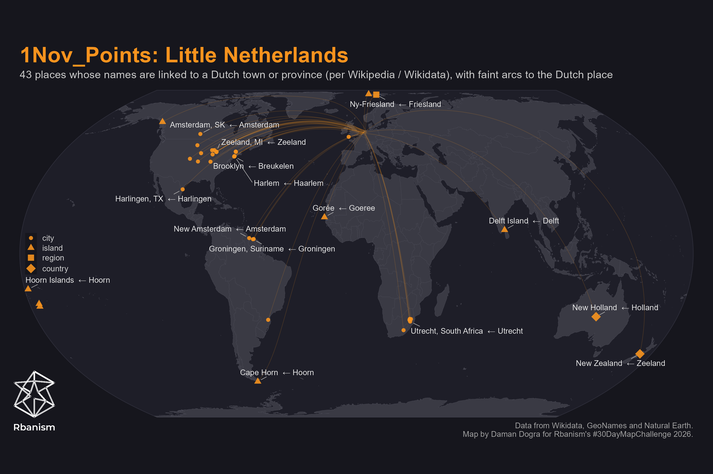

# 1Nov_Points: Little Netherlands

**Mapper:** Daman Dogra\
**Data:** Wikidata, GeoNames, Natural Earth (`data/namesakes.csv`)

## About the map

I wanted to see how far Dutch place names have travelled. This map plots 43 places whose names, according to Wikipedia or Wikidata, come from a Dutch town, city or province.

Each orange point is a namesake. Its shape gives the type of place, and a faint arc links it to its Dutch counterpart.

The clusters roughly follow Dutch history:

- New Netherland, now New York: Brooklyn (Breukelen), Harlem (Haarlem), Flushing (Vlissingen) and New Utrecht.
- 19th-century emigration to the US Midwest: Zeeland, Overisel, Vriesland, Drenthe and Borculo in Michigan, plus Friesland and Oostburg in Wisconsin.
- Colonies: Suriname and Guyana (Groningen, Nieuw Amsterdam, New Amsterdam).
- Boer settlements in South Africa: Utrecht, Amersfoort, Dordrecht, Ermelo and Amsterdam.
- Names left by Dutch explorers: Cape Horn and the Hoorn Islands (Hoorn), Tasman's Middelburg and Rotterdam islands in Tonga, New Holland (Australia), Delft Island in Sri Lanka, Gorée in Senegal, and New Zealand (Zeeland).

Place-name origins are not always certain, so this is a sample, not a complete list. A matching spelling alone was not enough to include a place, and places linked to Dutch *people* (Tasmania, Mauritius) or *ships* (Arnhem Land, Île Amsterdam) are left out.

## Process

I started from a Wikidata SPARQL query for items whose "named after" (P138) points to something in the Netherlands. That returned over 1,000 hits, mostly streets and features named after rivers. I curated the list by hand and kept a place only if Wikipedia or Wikidata explicitly links its name to a Dutch place. A shared spelling could be coincidence, so it wasn't enough. Middelburg (Eastern Cape) is "midway", Nieuw Nickerie is named after a river, and Haarlem (Western Cape) is only "presumably" Dutch. Coordinates are stored in `data/namesakes.csv`, so `map.R` runs offline.

The map uses `sf` and `ggplot2` in the Equal Earth projection, with the Natural Earth basemap from `rnaturalearth`. Labels use `ggrepel`. I passed every point to the repel layer (most with an empty label) so labels also avoid unlabelled points.

`st_segmentize()` on lon/lat data wants `lwgeom`, but `s2`, which ships with `sf`, can interpolate great circles on its own. The arcs to the Pacific islands are nearly antipodal: they run over the pole and end up tracing the edge of the Equal Earth map, so I dropped those three. And a hard-coded "Gorée" broke under the C locale until I wrote it as `\u00e9`.

## Files

- [`map.R`](map.R): R code
- [`map.png`](map.png): the map
- [`data/`](data): places data and Rbanism logo
- Original texts: [`map.md`](map.md), [`process.md`](process.md)
