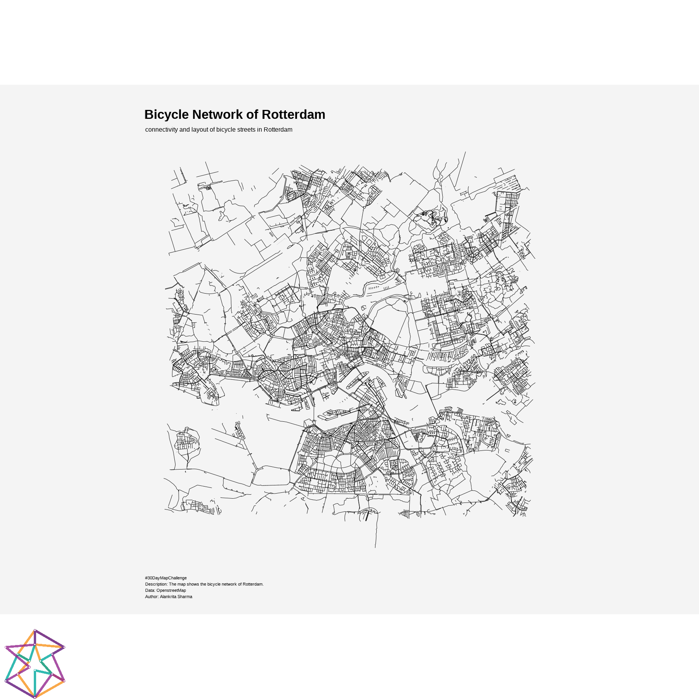

# 2Nov_Lines: Bicycle Network of Rotterdam

**Mapper:** Alankrita Sharma\
**Data:** OpenStreetMap\
**Instagram:** [@alankrita24](https://www.instagram.com/alankrita24/)

## About the map

The map shows the dedicated bicycle networks, along with the streets which hold a probability for cycling, which include the residential streets.

## Process

The process was an introduction into mapping with R for me. I began learning how geospatial analysis is integrated into programming software with coding, including its different parts of loading data sets, modifying them, and finally plotting the map. While it was challenging to map without a visual guide, it was interesting to understand the benefits of reciprocity which comes with using R for geospatial analytics.

## Files

- [`day 02 - lines.R`](day%2002%20-%20lines.R): R code ([Quarto version](day%2002%20-%20lines.qmd))
- [`Output/02Nov_BicycleStreets.png`](Output/02Nov_BicycleStreets.png): the map
- Original texts: [map description](day02_lines_alankrita_map%20description.Rmd), [process reflection](day02_lines_alankrita_process%20reflection.Rmd)
