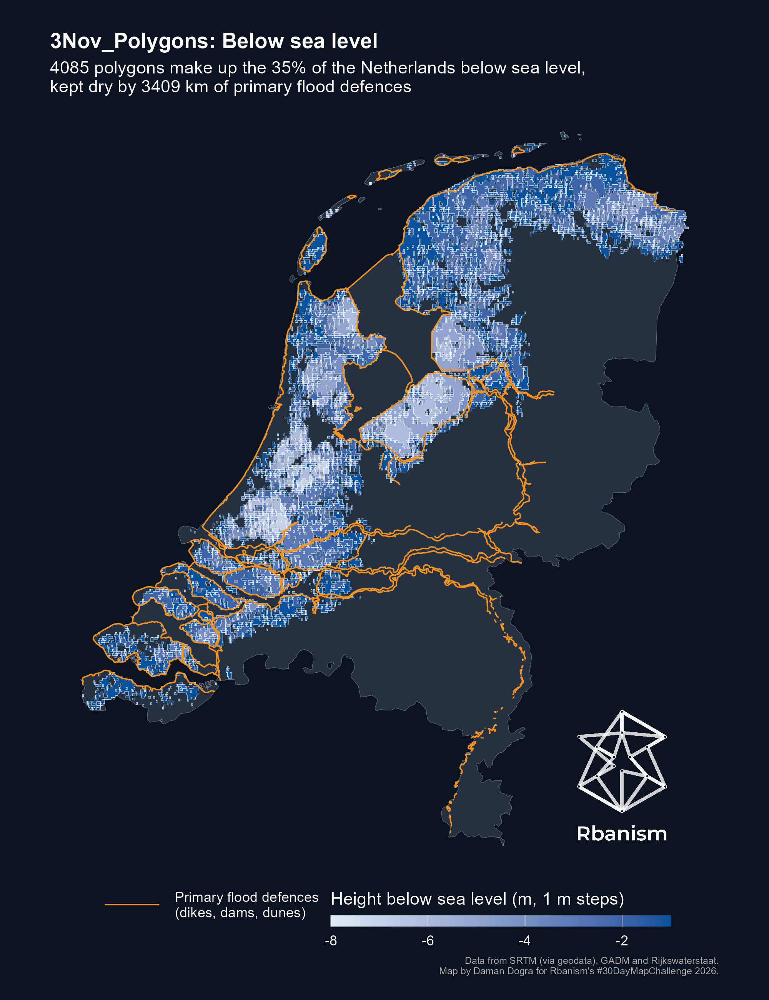

# 3Nov_Polygons: Below sea level

**Mapper:** Daman Dogra\
**Data:** SRTM elevation via `geodata`, GADM, Rijkswaterstaat (primary flood defences)

## About the map

This map shows the part of the Netherlands that lies below sea level as 4,085 polygons. It is about 35% of the country by this data. Each polygon is a patch of land within one metre step below sea level, outlined in white. Darker blue is just below 0 m, and the palest blocks are 6 to 8 m down. Land above sea level is the dark grey background. The orange lines are the 3,400 km of primary flood defences (dikes, dams and dunes) that keep it all dry.

You can read Dutch water history in the blocks: the nested polders of North and South Holland, with the deep Haarlemmermeer and Zuidplaspolder as pale centres, and Flevoland ringed by its own dike. The Afsluitdijk closes off the former Zuiderzee, and the river dikes follow the Rhine and Maas inland. The gaps are open water or higher ground.

The official figure is about a quarter of the country. The higher share here comes from the coarse (about 1 km) satellite elevation data. It smooths out dikes and dunes and is noisy near 0 m.

## Process

The map is made with one R script, `map.R`, using terra, sf, ggplot2, geodata and png.

1. `geodata::elevation_30s()` downloads SRTM elevation for the Netherlands (about 1 km resolution, masked to the country). `geodata::gadm()` gives the outline. Both are cached in `data/` with the white Rbanism logo.
2. `terra::as.polygons(elev < 0)` gives one polygon below and one above sea level. Their areas give the share below sea level, and a `stopifnot()` checks it is between 10% and 40%.
3. To make the polygons visible, the below-sea-level cells are floored to whole metres. `as.polygons()` then merges cells of the same step, and `disagg()` splits them into separate blocks.
4. Rijkswaterstaat's primary flood defences (NBPW, `nbpw_dijktrajecten_formeel`) are read from its WFS. On the first run they are simplified to 50 m and cached as `data/dikes.gpkg` (230 KB).
5. Everything is drawn with `geom_sf` in RD New (EPSG:28992) on a dark background. The blocks have thin white edges, the dikes are drawn in Rbanism orange, and the logo is added with `annotation_custom`.

One flat blue polygon looked like a blob. Splitting it into one-metre depth steps made the polygons readable, and adding the dikes shows why that land is still dry.

## Files

- [`map.R`](map.R): R code
- [`map.png`](map.png): the map
- [`data/`](data): elevation, outline, flood defences and Rbanism logo
- Original texts: [`map.md`](map.md), [`process.md`](process.md)
