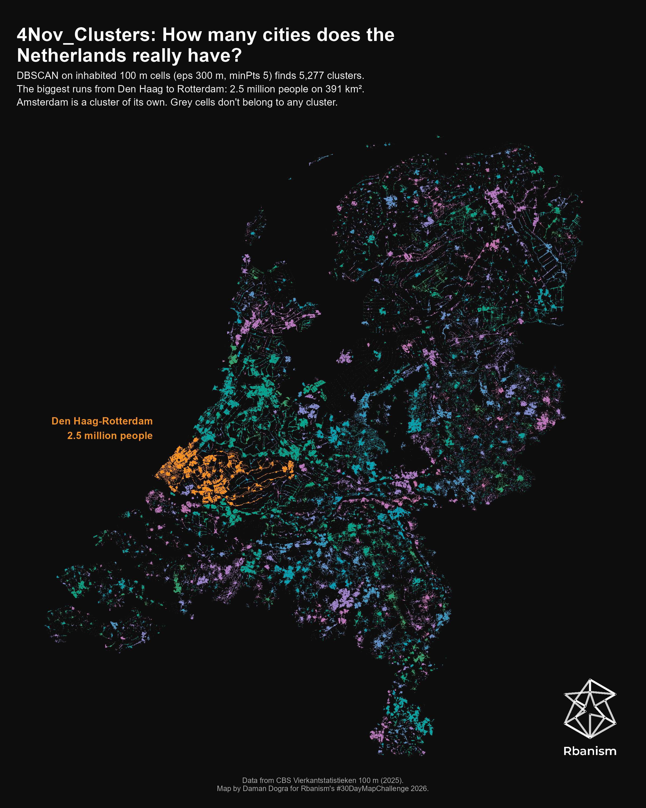

# 4Nov_Clusters: How many cities does the Netherlands really have?

**Mapper:** Daman Dogra\
**Data:** [CBS Vierkantstatistieken 100 m, 2025](https://www.cbs.nl/nl-nl/dossier/nederland-regionaal/geografische-data/kaart-van-100-meter-bij-100-meter-met-statistieken) (CC BY 4.0)

One DBSCAN run on 600,768 inhabited grid cells turns the Netherlands into 5,277 settlements. The largest stretches from Scheveningen to Gouda and holds 2.5 million people.

What the map shows: [map.md](map.md). How it was made: [process.md](process.md).

## Run it

From this folder: `Rscript map.R`. It rewrites `map.png`.

Packages: sf, terra, dbscan, ggplot2, png.

`data/inwoners.tif` is included, so only DBSCAN and the drawing run. Without it, the script downloads the 448 MB CBS grid to `C:/personal/SA-rbanism/cache/`; change that path in `map.R` on another machine. The settings I tested are listed in [process.md](process.md).

## Files

- [`map.R`](map.R): the whole pipeline
- [`map.png`](map.png): the map (638 KB)
- [`data/Logo_Rbanism_ White.png`](data/Logo_Rbanism_%20White.png) (117 KB)
- [`data/inwoners.tif`](data/inwoners.tif) (1.0 MB)
