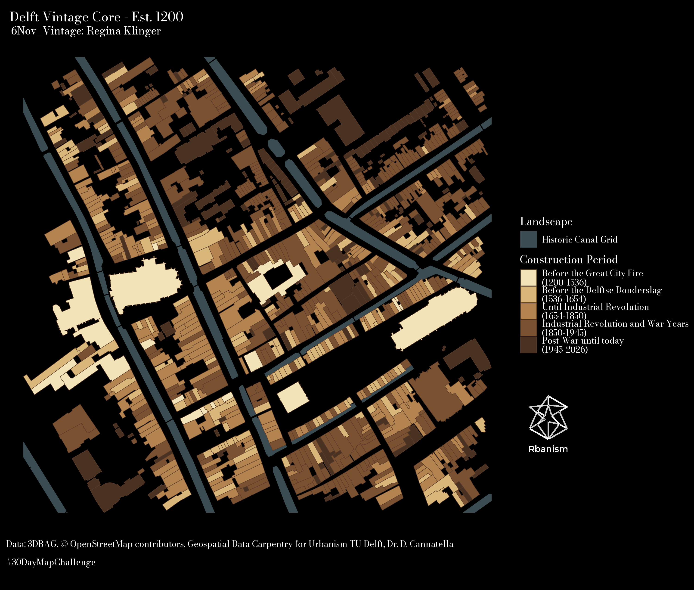

# 6Nov_Vintage: Delft Vintage Core - Est. 1200

**Mapper:** Regina Klinger\
**Data:** 3DBAG (v2025.09.03), © OpenStreetMap contributors, streets from Geospatial Data Carpentry for Urbanism (TU Delft), logo code adapted from Dr. D. Cannatella\
**Instagram:** [@regi.kling](https://www.instagram.com/regi.kling/)

## About the map

In fashion, vintage means pieces that are old, still worn, and valued because they have lasted. This map reads the historic centre of Delft the same way.

It shows the area around the Markt, the Oude Kerk and the Nieuwe Kerk, with every building coloured by its original construction year. The five periods follow turning points in Delft's history: the Great City Fire of 1536, the gunpowder explosion of 1654 (Delftse Donderslag), the start of industrialisation around 1850, and the end of the Second World War in 1945. The historic canal grid is shown in blue-grey.

The light shapes are the oldest pieces: the Oude Kerk, the Nieuwe Kerk and the Prinsenhof. Most of the surrounding fabric dates from the 17th to the early 20th century.

For my PhD on climate-adaptive design for historic urban landscapes, this is a starting point: old buildings and canals are not only heritage, but existing structures to build on.

Note: BAG construction years for very old buildings are often estimates.

## Process

Made entirely in R, building on the Geospatial Data Carpentry for Urbanism course (TU Delft).

Data:
- Buildings: one 3DBAG tile (10-282-562), transformed to RD New (EPSG:28992).
- Streets: the Delft streets shapefile from the course preparation files.
- Canals: OpenStreetMap via osmdata, cropped and saved to data/.

Classification: a histogram showed peaks on round years (1650, 1850). I grouped the years with case_when() and ordered them with factor() levels.

Map: ggplot2, Bodoni Moda via showtext, logo with magick and cowplot, adapted from code by Dr. D. Cannatella.

I wrote the code myself. An AI assistant explained concepts, error messages and why code is written the way it is, so I understood the logic of the language instead of just memorising expressions.

What I learned:
- how to stack several vector layers in one plot
- that R works sequentially and by position: case_when() checks conditions from top to bottom (first match wins), and scale_fill_manual() matches colours to factor levels by position
- that cowplot places the logo in normalised coordinates of the whole canvas (0 to 1), so I measured its position in the exported PNG instead of adjusting it manually

## Files

- [`map_R/6Nov_Vintage_ReginaKlingerScript.R`](map_R/6Nov_Vintage_ReginaKlingerScript.R): R code
- [`map_png/6Nov_Vintage_Map_RK.png`](map_png/6Nov_Vintage_Map_RK.png): the map
- [`data/`](data): buildings, canals, streets and Rbanism logo
- Original texts: [`map_md/`](map_md), [`process_md/`](process_md), [`handle_txt/`](handle_txt)
