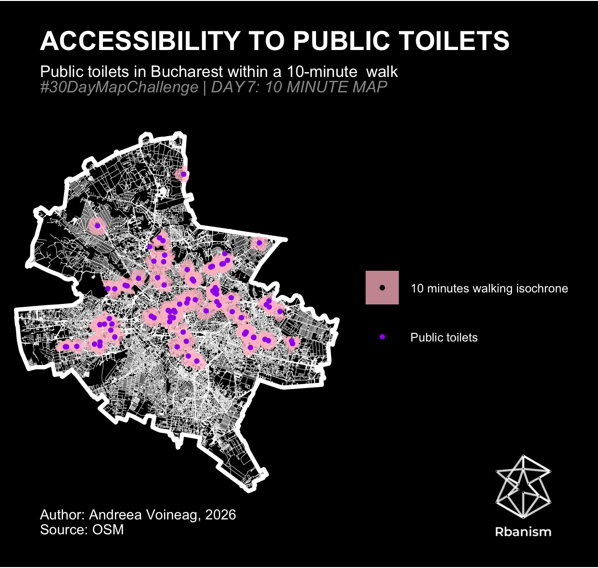

# 7Nov_10MinuteMap: Accessibility to Public Toilets

**Mapper:** Andreea Voineag\
**Data:** OpenStreetMap (city boundary, streets, public toilets), walking isochrones from OSRM\
**Instagram:** [@anvo600](https://www.instagram.com/anvo600/)

## About the map

The map shows which parts of Bucharest are within a 10-minute walk of a public toilet. Each pink area is a 10-minute walking isochrone around a public toilet (purple points), calculated along the street network.

Most of the covered area is concentrated in the city centre, while many outer neighbourhoods have no public toilet within a 10-minute walk.

## Process

**Steps**

1. I download the data from OSM: Bucharest's city boundary, street network of Bucharest and public toilets.
2. Loaded the data in R with `sf`.
3. Calculated a 10-minute walking isochrone for each toilet with `osrm::osrmIsochrone()`.
4. Saved the isochrones to a file, so they don't have to be recalculated.
5. Made the map with `ggplot2` and `geom_sf()`, added the logo with `cowplot` and formatted the subtitle with `ggtext`.

**What I learned**

A lot of things, because it was my first time working in RStudio. I had to find the right packages, understand what the functions do and get familiar with this new programming language.

- Requests to an online routing server are slow, so it's worth saving the results.
- How to plot multiple layers on the same map.
- In ggplot2, legends only appear for what is inside `aes()`, and the labels must match exactly in `scale_..._manual()`.

## Files

- [`day07_10-minute-map.R`](day07_10-minute-map.R): R code
- [`map.png`](map.png): the map
- [`data/`](data): boundary, streets, toilets, isochrones and Rbanism logo
- Original texts: [`map.md`](map.md), [`process.md`](process.md), [`handle.txt`](handle.txt)
