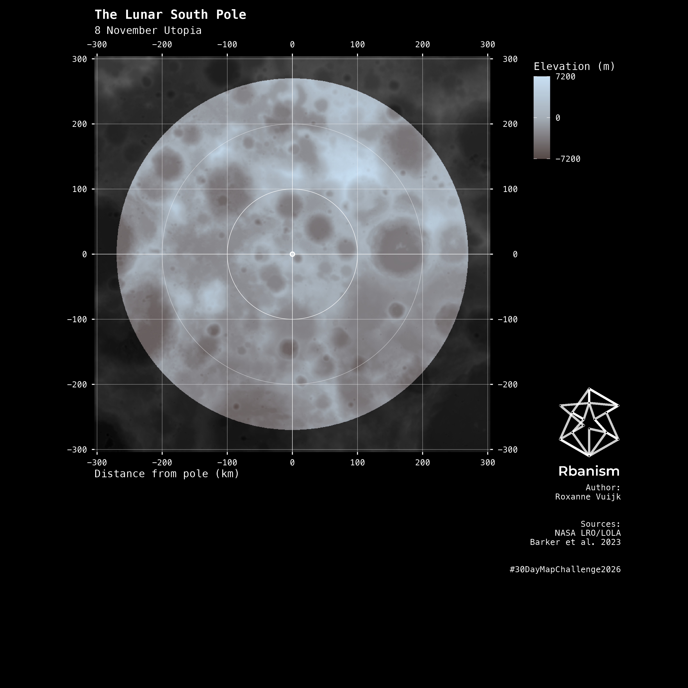

# 8Nov_Utopia: The Lunar South Pole

**Mapper:** Roxanne Vuijk\
**Data:** NASA LRO/LOLA south polar elevation model, 80 m/pixel (Barker et al., 2023, *Planet. Sci. J.* 4, 183; DOI: 10.60903/gsfcpgda-lola-spole)

## About the map

This map shows the Lunar South Pole region as mapped by NASA LRO/LOLA mission in 2023. The region is mapped from 80°S to the pole itself and the square covers 608 by 608 km, centred on the pole (the white dot). All NASA's candidate regions for the first crewed Artemis landing all lie within this map. In the new space race, all eyes are on the polar regions as they may contain ice water in the crater floors that never see sunlight.

The map shows the craters, with their elevation relative to the Moon its mean radius. The darker the lower the terrain. Within this map the terrain ranges from about -7300 to +7000 m in height. The grid and rings mark distances from the pole.

The data comes directly from NASA: NASA LRO/LOLA south polar elevation model, 80 m/pixel (Barker et al., 2023, *Planet. Sci. J.* 4, 183), simplified to 640 m/pixel for the benefit of the map making process.

## Process

Because I am graduating on the topic of lunar territory, I chose the Lunar South Pole for this map challenge. Through this challenge I hoped to get better acquainted with making maps of its surface. I chose a theme (elevation) that is easily and publicly accessible through NASA its website and quickly found the data I needed.

I have used RStudio before in a course to make maps and got really interested in it. Participating in this challenge allowed me to play around with code to visualize and to transform data. Since I am new to the R world I was in need of some guidance, so I used AI to tutor me and with troubleshooting. It did not write my codes, it did help me fix them.

I learned to read a raster's summary and to simplify it with the aggregate argument. Before I started I had in mind how I wanted the map to look like. I converted the raster into a table of points (x, y, z(elevation)) to translate it to a nice map. My idea was to create a round map, and I decided along the way to project it over a gray toned square. Then I cut out the circle by keeping the points within a certain radius of the pole.

Lastly, I was playing around with the visualization tools, which I had also done in the course, and learned some new tricks such as fonts, grid lines, etc. The logo placement then was a struggle and I wouldn't have managed without the help of some AI.

## Files

- [`map.R`](map.R): R code (downloads the elevation data from NASA)
- [`map.png`](map.png): the map
- Original texts: [`description.md`](description.md), [`reflection.md`](reflection.md)
