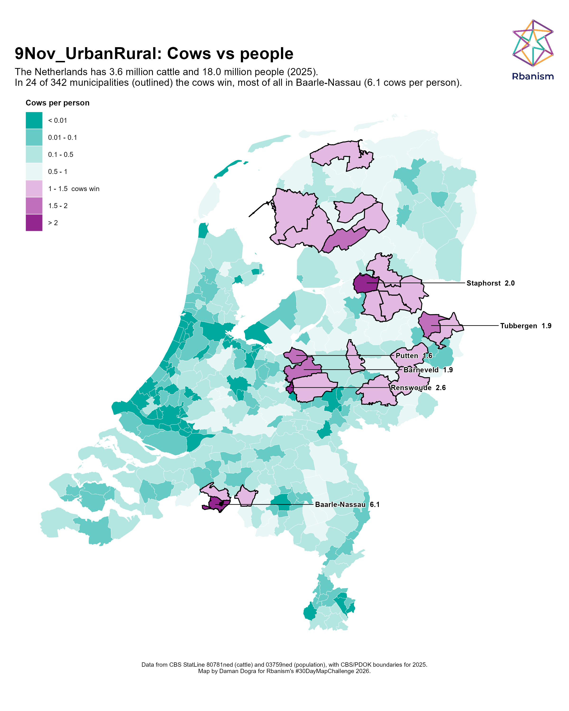

# 9Nov_UrbanRural: Cows vs people

**Mapper:** Daman Dogra\
**Data:** CBS StatLine [80781ned](https://opendata.cbs.nl/statline/#/CBS/nl/dataset/80781ned) (cattle) and [03759ned](https://opendata.cbs.nl/statline/#/CBS/nl/dataset/03759ned) (population), both CC BY 4.0; [CBS/PDOK gebiedsindelingen 2025](https://service.pdok.nl/cbs/gebiedsindelingen/2025/wfs/v1_0) (CC BY 4.0)

Cows outnumber people in 24 of the 342 municipalities. Baarle-Nassau has 6 cows for every resident.

What the map shows: [map.md](map.md). How it was made: [process.md](process.md).

## Run it

From this folder: `Rscript map.R`. It rewrites `map.png`.

Packages: sf, cbsodataR, ggplot2, ggrepel, png.

`data/cows.gpkg` holds the joined 2025 figures. Delete it to fetch everything again from the CBS OData API and PDOK.

## Files

- [`map.R`](map.R): the whole pipeline
- [`map.png`](map.png): the map (756 KB)
- [`data/Logo_Rbanism_ Full.png`](data/Logo_Rbanism_%20Full.png) (121 KB)
- [`data/cows.gpkg`](data/cows.gpkg) (1.1 MB)
