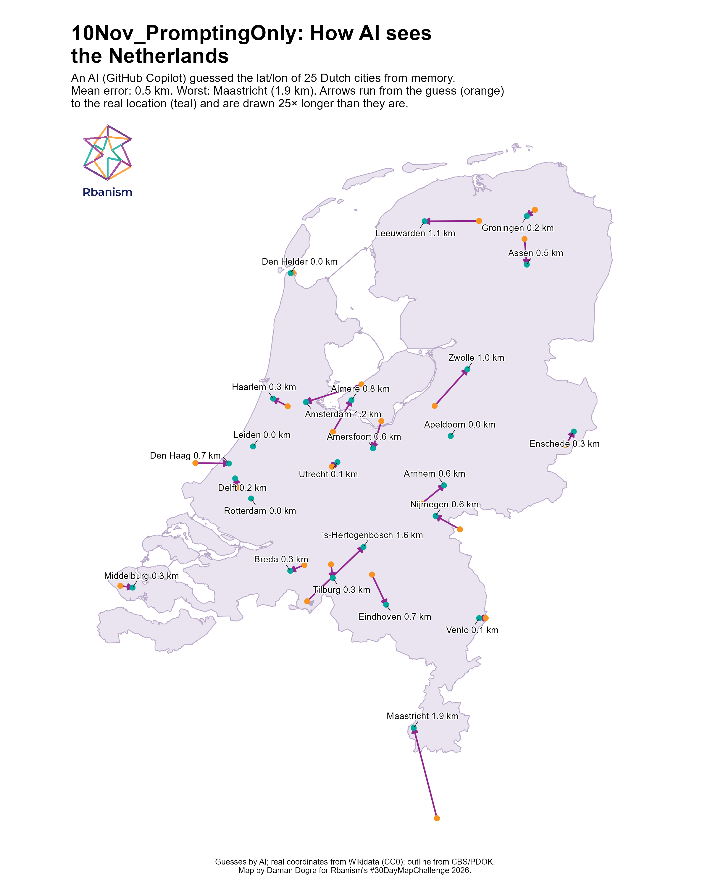

# 10Nov_PromptingOnly: How AI sees the Netherlands

**Mapper:** Daman Dogra\
**Data:** guesses written by GitHub Copilot (`data/ai_guesses.csv`), [Wikidata](https://www.wikidata.org) (CC0), CBS/PDOK provinces 2025 (CC BY 4.0)

An AI's from-memory coordinates for 25 Dutch cities, checked against Wikidata. The mean error is 0.5 km.

What the map shows: [map.md](map.md). How it was made: [process.md](process.md).

## Run it

From this folder: `Rscript map.R`. It rewrites `map.png`.

Packages: sf, ggplot2, ggrepel, httr, png.

The guesses are fixed in `data/ai_guesses.csv`. `data/real.csv` and `data/nl.gpkg` are fetched from Wikidata and PDOK only if they're missing. The exact prompts are in [process.md](process.md).

## Files

- [`map.R`](map.R): the whole pipeline
- [`map.png`](map.png): the map (532 KB)
- [`data/Logo_Rbanism_ Full.png`](data/Logo_Rbanism_%20Full.png) (121 KB)
- [`data/ai_guesses.csv`](data/ai_guesses.csv) (1 KB)
- [`data/nl.gpkg`](data/nl.gpkg) (225 KB)
- [`data/real.csv`](data/real.csv) (1 KB)
