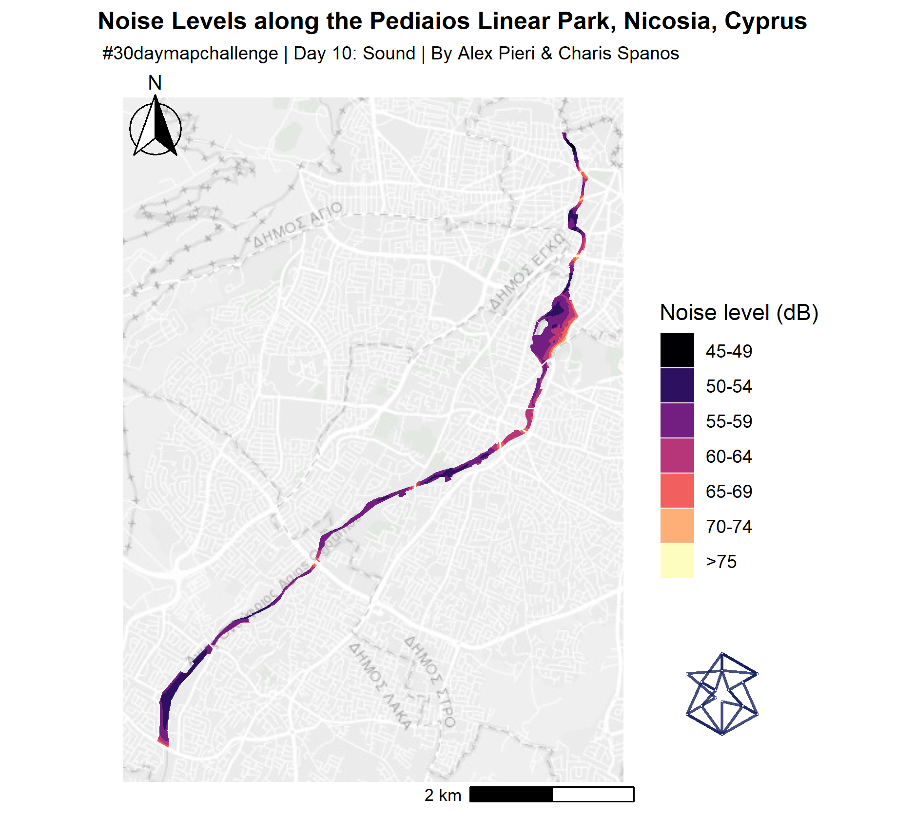

# 11Nov_Sound: Noise Levels along the Pediaios Linear Park, Nicosia, Cyprus

**Mappers:** Alex Pieri & Charalambos Spanos\
**Data:** Daytime noise data and park area (`data/raw_data/`), basemap: Esri World Gray Canvas

## About the map

*Description to follow.*

## Process

*Description to follow.*

## Files

- [`code/day11_sound.R`](code/day11_sound.R): R code
- [`results/maps/day11_sound.png`](results/maps/day11_sound.png): the map
- [`data/`](data): noise data, park area and Rbanism logo
