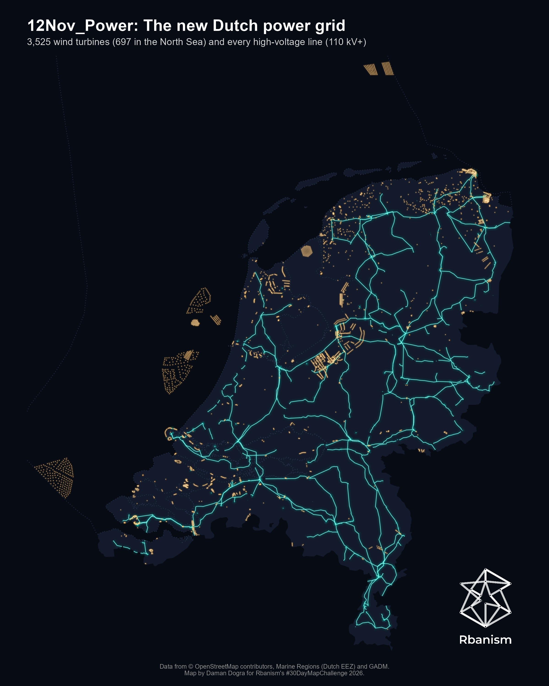

# 12Nov_Power: The new Dutch power grid

**Mapper:** Daman Dogra\
**Data:** [OpenStreetMap](https://www.openstreetmap.org/copyright) (© OpenStreetMap contributors, ODbL), [Marine Regions](https://www.marineregions.org) (Dutch EEZ), [GADM](https://gadm.org) (non-commercial use)

3,525 wind turbines, 697 of them at sea, drawn over every Dutch power line of 110 kV and up.

What the map shows: [map.md](map.md). How it was made: [process.md](process.md).

## Run it

From this folder: `Rscript map.R`. It rewrites `map.png`.

Packages: sf, osmdata, geodata, ggplot2, png.

`data/power.gpkg` is included. Without it, the script makes two Overpass queries over the whole country plus the EEZ. These take a few minutes and sometimes fail with a 502; just run it again.

## Files

- [`map.R`](map.R): the whole pipeline
- [`map.png`](map.png): the map (1.3 MB)
- [`data/Logo_Rbanism_ White.png`](data/Logo_Rbanism_%20White.png) (117 KB)
- [`data/power.gpkg`](data/power.gpkg) (2.1 MB)
