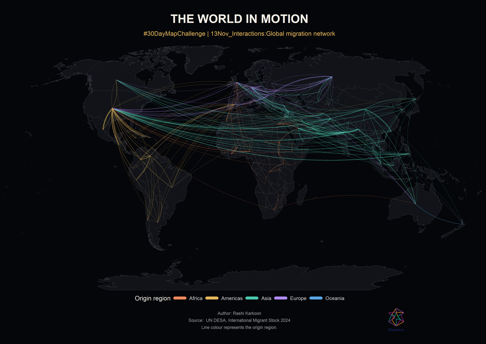

# 13Nov_Interactions: The World in Motion

**Mapper:** Rashi Karkoon\
**Data:** UN DESA, Population Division, International Migrant Stock 2024 (`data/UN_migration_2024.xlsx`)\
**Instagram:** [@\_.rashi.75\_](https://www.instagram.com/_.rashi.75_/)

## About the map

**The World in Motion: Mapping Global Migration Networks**

This map visualises the strongest migration connections across the world from the year of 2024, using data from the United Nations Department of Economic and Social Affairs (UN DESA), International Migrant Stock 2024 data. It explores how people are distributed across national boundaries and how countries are interconnected through migration.

The map approaches the theme of Interaction through the lens of international migration, understanding how people move across the countries and borders. The interaction is through the people, culture, knowledge, societies and even everyday practices. The migration in itself is an interconnected network that continue to influence and transform each society – the origin and the destination, both.

In the map, each line’s colour shows the origin country (as per the continent) leading to the destination country and its thickness corresponds to the number of migrations; these both helps visualise a broader pattern within the global network. This also represents concentrations and uneven distribution of the network in different parts of the world.

The map aims to communicate the scale, direction and interconnected nature of international migration through a single global visualisation.

## Process

**Reflection: Learning R through Mapping**

As someone relatively new to R and programming, this exercise was challenging but rewarding. I think I chose a relatively easier interpretation of the theme as I wanted to focus more on learning the coding process. I began with a basic idea, broke it into steps and explored different datasets before settling on this one.

I took help from AI to identify and understand commands that seemed logically necessary but that I struggled to pinpoint or find examples of within the given timeframe. A close friend, who is a computer scientist and software developer, also helped me clarify doubts, understand the code and resolve technical issues.

I learnt to clean and organise datasets, match data sources using common identifiers and work with geospatial concepts such as the Robinson projection. One challenge was creating curved migration connections. My initial map used straight lines, which did not reflect the visualisation I had imagined. Exploring mathematical curves and functions helped me achieve a more suitable representation.

I also underestimated the time needed for visual composition and alignment. Overall, the exercise made R feel less intimidating and encouraged me to experiment with code more independently.

## Files

- [`map.R`](map.R): R code
- [`map.png`](map.png): the map
- [`data/`](data): migration data and Rbanism logo
- Original texts: [`map.md`](map.md), [`process.md`](process.md), [`handle.md`](handle.md)
