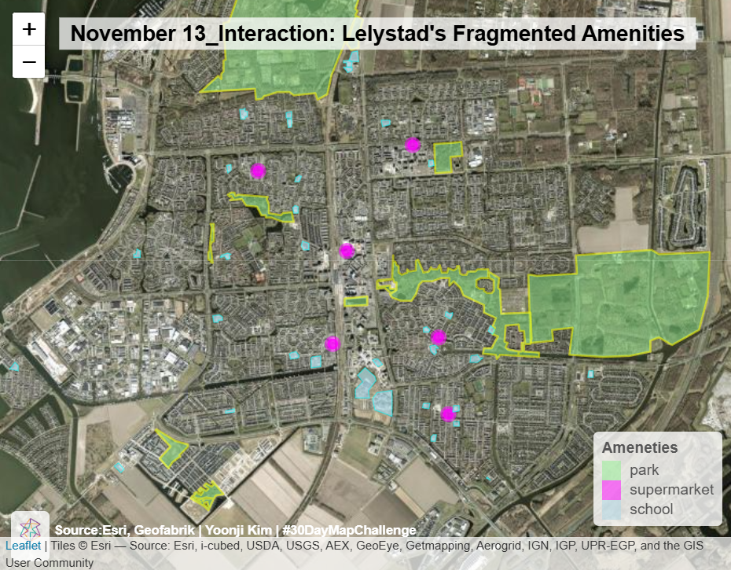

# 13Nov_Interactions: Lelystad's Fragmented Amenities

**Mapper:** Yoonji Kim\
**Data:** Esri, Geofabrik (OpenStreetMap extract, `input/flevoland.gpkg`)\
**Interactive map:** [`Day13_Interaction_YoonjiKim.html`](Day13_Interaction_YoonjiKim.html) (download and open in a browser)

## About the map

Lelystad is a quintessential modernist-planned Dutch city. Its prime objective was to provide housing to younger families commuting to Amsterdam. This purpose was so dominant that life inside the city itself became secondary to the efficiency of commuting. High velocity motorways dissect the city into several neighborhoods which stand totally separated from each other. Core amenities are distributed within each town, containing and reducing the 'urban life' inside a delineated area.

## Process

I chose to explore the basics of the Leaflet package, which seemed to be the go-to tool for interactive maps. After adding some markers manually, I realized its application on datasets with multiple attributes would be much more meaningful. However, as OSM data is full of NullData, this tool would be more useful with statistical datasets with geographical attributes. I found the addition of text labels quite challenging, as you needed to feed html objects and not string. Nevertheless it wouldn't stop me from exploring this package further, as it comes with detailed documentations and advises from the R community.

## Files

- [`Daly13_Yoonji.R`](Daly13_Yoonji.R): R code
- [`Day13_Interaction_YoonjiKim.png`](Day13_Interaction_YoonjiKim.png): screenshot of the map
- [`Day13_Interaction_YoonjiKim.html`](Day13_Interaction_YoonjiKim.html): interactive Leaflet map
- [`input/`](input): OSM data and Rbanism logo
- Original text: [`Desciption&Reflection.txt`](Desciption%26Reflection.txt)
