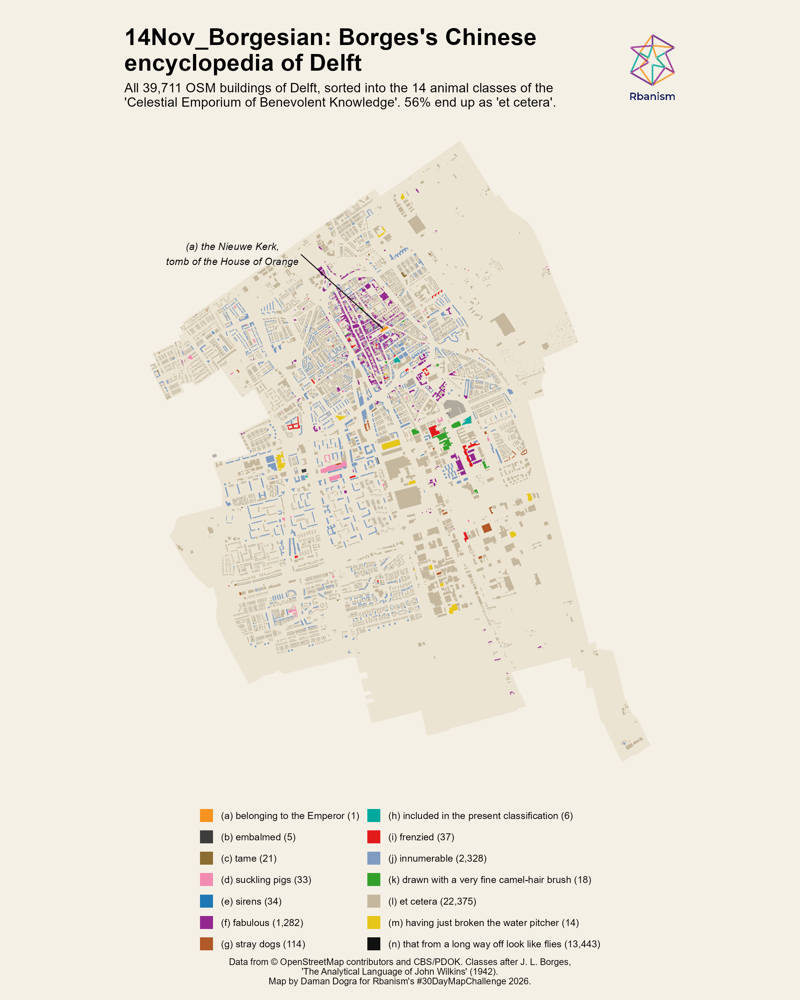

# 14Nov_Borgesian: Borges's Chinese encyclopedia of Delft

**Mapper:** Daman Dogra\
**Data:** [OpenStreetMap](https://www.openstreetmap.org/copyright) (© OpenStreetMap contributors, ODbL), [CBS/PDOK gebiedsindelingen 2025](https://service.pdok.nl/cbs/gebiedsindelingen/2025/wfs/v1_0) (CC BY 4.0)

All 39,711 buildings in Delft, sorted into the 14 classes of Borges's imaginary Chinese encyclopedia. The full rule table is in [process.md](process.md).

What the map shows: [map.md](map.md). How it was made: [process.md](process.md).

## Run it

From this folder: `Rscript map.R`. It rewrites `map.png`.

Packages: sf, osmdata, ggplot2, dplyr, ggrepel, png.

`data/borges.gpkg` stores only the class and a simplified outline per building. Delete it to re-query Overpass and re-run the classification.

## Files

- [`map.R`](map.R): the whole pipeline
- [`map.png`](map.png): the map (1.3 MB)
- [`data/Logo_Rbanism_ Full.png`](data/Logo_Rbanism_%20Full.png) (121 KB)
- [`data/borges.gpkg`](data/borges.gpkg) (7.0 MB)
