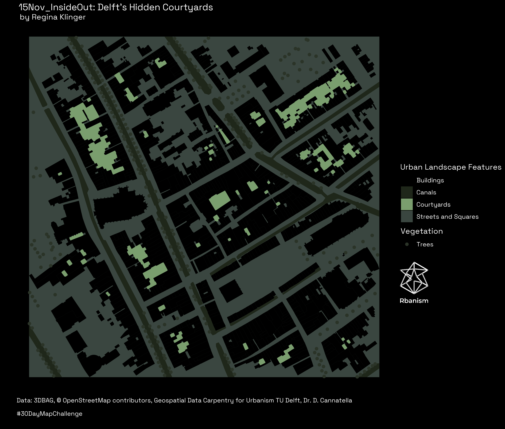

# 15Nov_InsideOut: Delft's Hidden Courtyards

**Mapper:** Regina Klinger\
**Data:** 3DBAG (v2025.09.03), © OpenStreetMap contributors (canals, trees), Geospatial Data Carpentry for Urbanism (TU Delft), logo code adapted from Dr. D. Cannatella\
**Instagram:** [@regi.kling](https://www.instagram.com/regi.kling/)

## About the map

From the street, the historic centre of Delft looks completely built up. Behind the facades, however, the blocks hide courtyards and gardens that nobody passing by can see.

This map turns the city inside out. The buildings are drawn in black and recede, while the unbuilt space becomes the visible structure: streets, squares and canals form one dark network, and the enclosed courtyards light up in green.

In the tile around the Markt, Oude Kerk and Nieuwe Kerk, I found 54 enclosed courtyards with a total area of about 11,600 m². They are the open spaces that are not connected to the street network, hidden inside the building blocks.

Not all of this space is green today. Some of it is paved, used as terraces or for storage. But for my PhD on climate-adaptive design for historic urban landscapes, these courtyards are exactly the point: unsealed, planted and connected, they could cool the dense historic city and absorb rainwater, without changing a single historic facade.

## Process

Made entirely in R, building on my Day 6 Vintage script and the Geospatial Data Carpentry for Urbanism course (TU Delft).

Data:
- Buildings: one 3DBAG tile (10-282-562), transformed to RD New (EPSG:28992).
- Canals: OpenStreetMap, saved from my Vintage map.
- Trees: OpenStreetMap via osmdata, queried with a bounding box in WGS84 after the full-city query timed out.

Courtyards: I merged the buildings into blocks with st_buffer(), st_union() and a negative buffer to close small gaps. st_difference() cut the blocks out of the tile, st_cast() split the open space into 55 pieces, and st_area() with filter() removed the largest piece, the street network, leaving 54 courtyards.

I wrote the code myself. An AI assistant explained concepts, error messages and why code is written the way it is.

What I learned:
- how to derive new geometries from existing ones instead of downloading more data
- the difference between fill and colour, and that points ignore fill
- that a legend needs aes() labels, and named colours in the scale
- that file names in ggsave() need an extension

## Files

- [`map_R/15_Nov_InsideOut_ReginaKlingerScript.R`](map_R/15_Nov_InsideOut_ReginaKlingerScript.R): R code
- [`map_png/15Nov_InsideOut_ReginaKlinger.png`](map_png/15Nov_InsideOut_ReginaKlinger.png): the map
- [`data/`](data): buildings, canals, trees and Rbanism logo
- Original texts: [`map_md/`](map_md), [`process_md/`](process_md), [`handle_txt/`](handle_txt)
