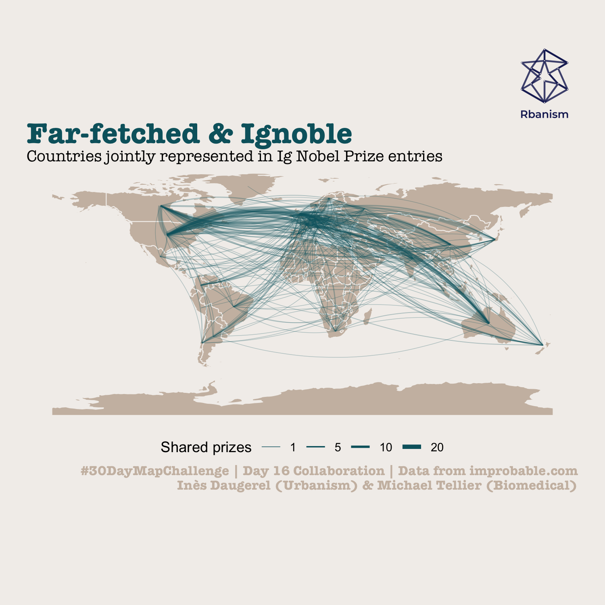

# 16Nov_CollaborativeMap: Far-fetched & Ignoble

**Mappers:** Inès Daugerel (Urbanism) & Michael Tellier (Biomedical)\
**Data:** Ig Nobel Prize winners from improbable.com (`data/Ig_Nobel_categories.csv`)

## About the map

This map retraces the collaboration network that the Ig Nobel Prize has been creating since 1991. We plotted the number of collaborations for any given prizes that included at minima one international collaboration.

Our team is collaborative by nature, one of us being a bioinformatician and the other an urbanist. This might be an improbable collaboration at first sight, and it prompted us to see what other improbable partnerships could do. And what better inspiration than the Ig Nobel prize?

More interestingly (or not), we wondered how these partnerships were scattered around the world. Aside from giving an understanding of the geographical distribution of the research endeavours rewarded by IG, we wondered what amount of institutional and geographical frictions these partnerships had to overcome to make their groundbreaking discoveries. We'll leave the interpretation to the reader.

## Process

After having forgotten how to insert the Rbanism logo, had to relearn that this year. We struggled with finding how to place a meaningful "point of connection" for each country, trying at first the centroid. First time using naturalearth package as well.

## Files

- [`DAY16_COLLABORATION.R`](DAY16_COLLABORATION.R): R code
- [`DAY16_COLLABORATION.png`](DAY16_COLLABORATION.png): the map
- [`data/`](data): Ig Nobel data
- Original text: [`DAY-16-COLLABORATION.md`](DAY-16-COLLABORATION.md)
