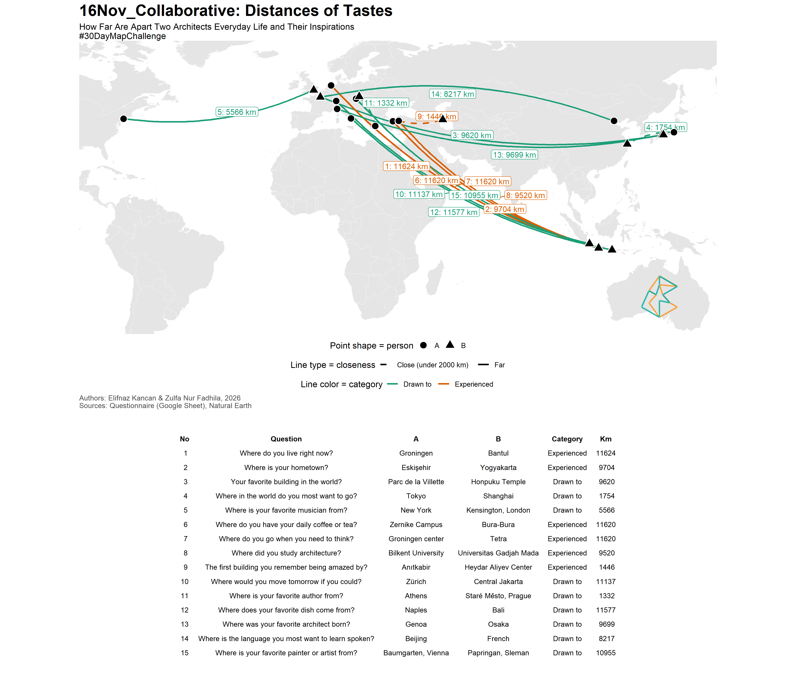

# 16Nov_CollaborativeMap: Distances of Tastes

**Mappers:** Elifnaz Kancan & Zulfa Nur Fadhila\
**Data:** Questionnaire answers (Google Sheet, `data/Distance of Tastes (Filled).xlsx`), Natural Earth\
**Instagram:** [@enkancan](https://www.instagram.com/enkancan/), [@dhils31](https://www.instagram.com/dhils31/)

## About the map

Distance of Tastes asks a simple question: how far apart are two architects' tastes? We answered the same 15 questions, each refers to one place: where we live, where we studied, our favourite building, the author we love, the language we most want to learn, etc. Then we measured the distance between each pair of answers.

Every curved line is one question. Circles are person A's places and triangles are person B's. Orange lines are places we have experienced (such as where we live, our hometowns, our daily coffee spots, where we studied). Green lines are places we are drawn to (such as dream trip, favourite building, favourite artist). Dashed lines to show which our answers that are less than 2,000 km apart. Each line shows its question number and distance in km; the table below the map, lists every question and answer.

Our daily lives are far apart: where we live, have coffee and think are all about 11,600 km from each other. What inspires us is closer: our favourite authors, our dream trips and the first building that amazed us are only 1,300 to 1,800 km apart.

Distances are great-circle distances while the curves are only for readability.

## Process

We were both new to R and to mapping with code, so we started from the GDCU course videos and short guidebooks made from them. We collected our answers in a shared Google Sheet, copied coordinates from Google Maps, and worked in RStudio (Posit Cloud and desktop).

In R we read the Excel file, split each "latitude, longitude" cell into two numbers, built points with sf, and measured every pair of answers with st_distance. Then we layered the map in ggplot2: world map, curved lines, number labels, points, and a table underneath.

Because of the limited time, we used AI assistance to help with the layering and plotting part, also when we find some errors. We ran and edited the code ourselves.

What we learned: sf wants longitude before latitude; a distance on the globe is not a straight line on a flat map; and most of our errors were small ones, like a missing comma, a wrong working directory or an object defined too late.

## Files

- [`map.R`](map.R): R code
- [`distances_of_two_tastes.png`](distances_of_two_tastes.png): the map
- [`data/`](data): questionnaire answers and Rbanism logo
- Original texts: [`map.md`](map.md), [`process.md`](process.md), [`handle.txt`](handle.txt)
