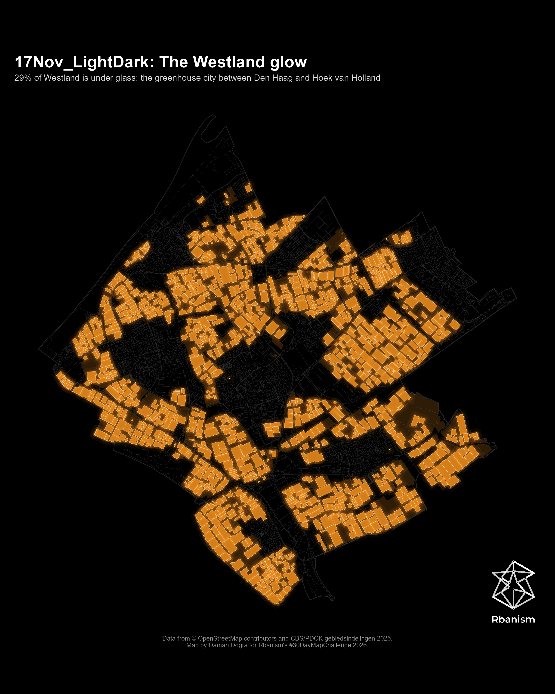

# 17Nov_LightDark: The Westland glow

**Mapper:** Daman Dogra\
**Data:** [OpenStreetMap](https://www.openstreetmap.org/copyright) (© OpenStreetMap contributors, ODbL), [CBS/PDOK gebiedsindelingen 2025](https://service.pdok.nl/cbs/gebiedsindelingen/2025/wfs/v1_0) (CC BY 4.0)

Westland's greenhouses as a glowing orange city on black. 29% of the municipality is under glass.

What the map shows: [map.md](map.md). How it was made: [process.md](process.md).

## Run it

From this folder: `Rscript map.R`. It rewrites `map.png`.

Packages: sf, osmdata, ggplot2, png.

`data/westland.gpkg` holds the dissolved greenhouses and roads for Westland. Delete it to re-query Overpass.

## Files

- [`map.R`](map.R): the whole pipeline
- [`map.png`](map.png): the map (2.9 MB)
- [`data/Logo_Rbanism_ White.png`](data/Logo_Rbanism_%20White.png) (117 KB)
- [`data/westland.gpkg`](data/westland.gpkg) (3.8 MB)
