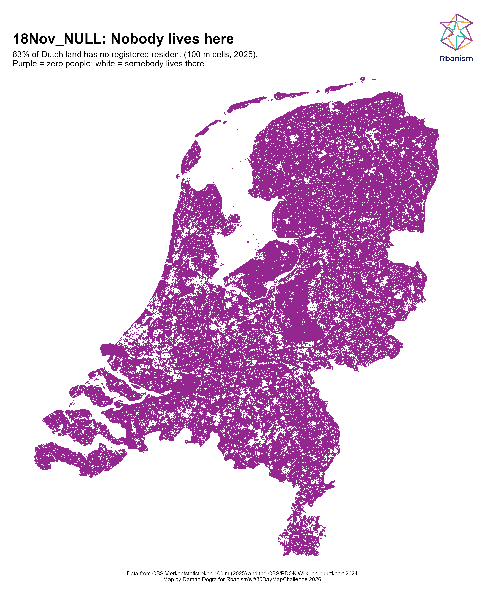

# 18Nov_NULL: Nobody lives here

**Mapper:** Daman Dogra\
**Data:** [CBS Vierkantstatistieken 100 m, 2025](https://www.cbs.nl/nl-nl/dossier/nederland-regionaal/geografische-data/kaart-van-100-meter-bij-100-meter-met-statistieken) (CC BY 4.0); [CBS/PDOK Wijk- en buurtkaart 2024](https://service.pdok.nl/cbs/wijkenbuurten/2024/wfs/v1_0) (CC BY 4.0)

Every 100 m cell of Dutch land where nobody is registered as living: 83% of the land.

What the map shows: [map.md](map.md). How it was made: [process.md](process.md).

## Run it

From this folder: `Rscript map.R`. It rewrites `map.png`.

Packages: sf, terra, ggplot2, png.

`data/nobody.tif` is included. Without it, the script downloads the 448 MB CBS grid and the municipal land polygons to `C:/personal/SA-rbanism/cache/`; change that path in `map.R` on another machine.

## Files

- [`map.R`](map.R): the whole pipeline
- [`map.png`](map.png): the map (445 KB)
- [`data/Logo_Rbanism_ Full.png`](data/Logo_Rbanism_%20Full.png) (121 KB)
- [`data/nobody.tif`](data/nobody.tif) (439 KB)
