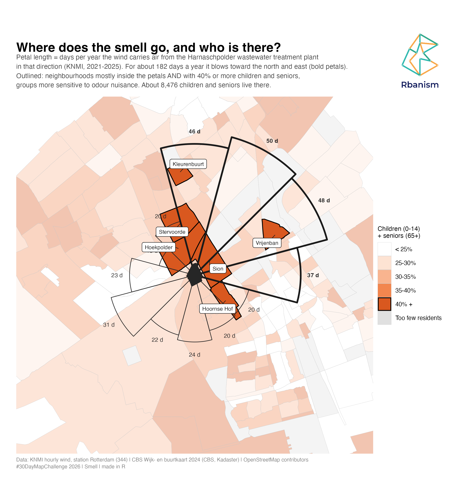

# 19Nov_Smell: Where does the smell go, and who is there?

**Mapper:** Cinco Yu\
**Data:** KNMI hourly wind, station Rotterdam (344), CBS Wijk- en buurtkaart 2024 (CBS, Kadaster), © OpenStreetMap contributors

## About the map

*Description to follow.*

## Process

*Description to follow.*

## Files

- [`06_final.R`](06_final.R): R code
- [`30DMC2026_smell.png`](30DMC2026_smell.png): the map
