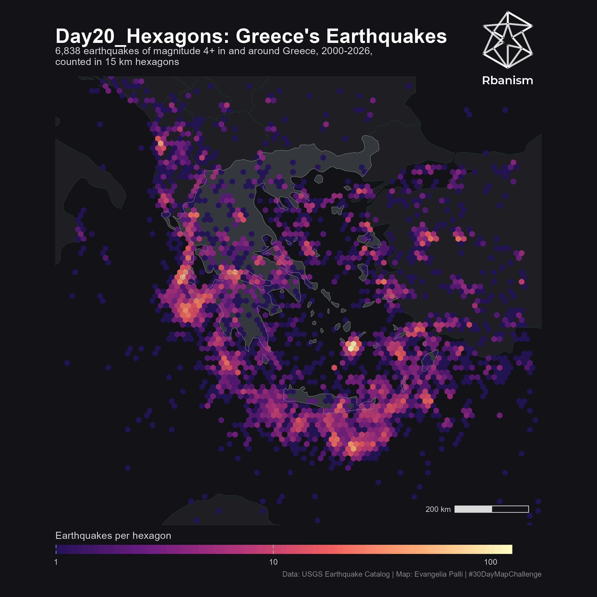

# 20Nov_Hexagons: Greece's Earthquakes

**Mapper:** Evangelia Palli
**Data:** [USGS Earthquake Catalog](https://earthquake.usgs.gov/fdsnws/event/1/) (`greece_earthquakes.csv`)

## About the map

This map shows 6,838 earthquakes of magnitude 4 or higher in and around Greece between 2000 and 2026. Each earthquake is counted in a 15 km hexagon, and the colour shows how many earthquakes happened in that hexagon, on a log scale.

The pattern follows the Hellenic Arc, where the African plate slides beneath the Aegean. The brightest areas are the arc south of Crete, the Ionian coast around Kefalonia and the western Peloponnese, and a cluster near Santorini and Amorgos. Activity is also high in the North Aegean and in western Turkey, while the interior of mainland Greece is much quieter.

## Process

I downloaded the earthquake data from the USGS API with `read.csv()` and saved it as a CSV. Using `sf`, I turned the points into spatial data and projected them to the Greek Grid (EPSG:2100), so all hexagons have the same area. I built the hexagon grid with `st_make_grid(square = FALSE)` and counted the earthquakes per hexagon with `st_join()` and `dplyr`. The map was made with `ggplot2`, with country outlines from the `maps` package, a scale bar from `ggspatial` and the logo added with `patchwork`.

I learned how to build hexagon grids in R, why the choice of map projection matters, how a log colour scale can reveal patterns in skewed data, and how to fix column-name clashes when joining tables.
