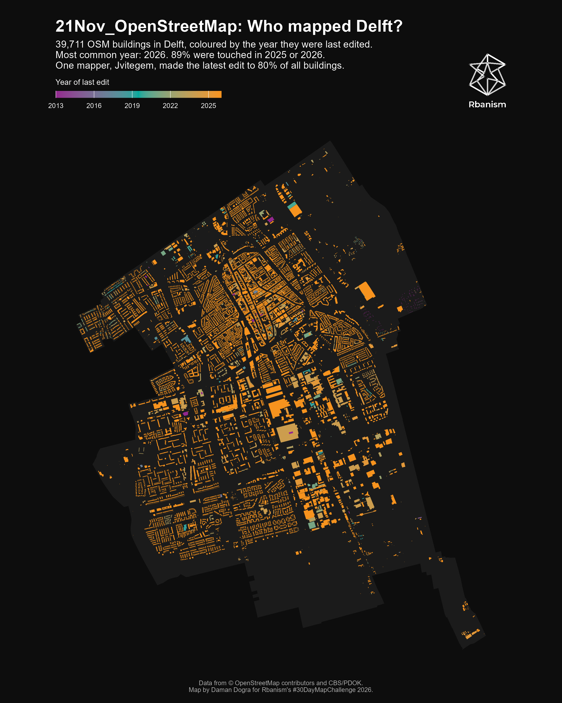

# 21Nov_OpenStreetMap: Who mapped Delft?

**Mapper:** Daman Dogra\
**Data:** [OpenStreetMap](https://www.openstreetmap.org/copyright) (© OpenStreetMap contributors, ODbL), [CBS/PDOK gebiedsindelingen 2025](https://service.pdok.nl/cbs/gebiedsindelingen/2025/wfs/v1_0) (CC BY 4.0)

Delft's OSM buildings coloured by the year of their last edit. 89% were touched in 2025 or 2026, mostly by one mapper.

What the map shows: [map.md](map.md). How it was made: [process.md](process.md).

## Run it

From this folder: `Rscript map.R`. It rewrites `map.png`.

Packages: sf, osmdata, ggplot2, png.

`data/delft.gpkg` stores the edit year and the last editor per building. Re-downloading it uses an `out = "meta"` Overpass query, which took about 10 minutes.

## Files

- [`map.R`](map.R): the whole pipeline
- [`map.png`](map.png): the map (1.5 MB)
- [`data/Logo_Rbanism_ White.png`](data/Logo_Rbanism_%20White.png) (117 KB)
- [`data/delft.gpkg`](data/delft.gpkg) (8.5 MB)
