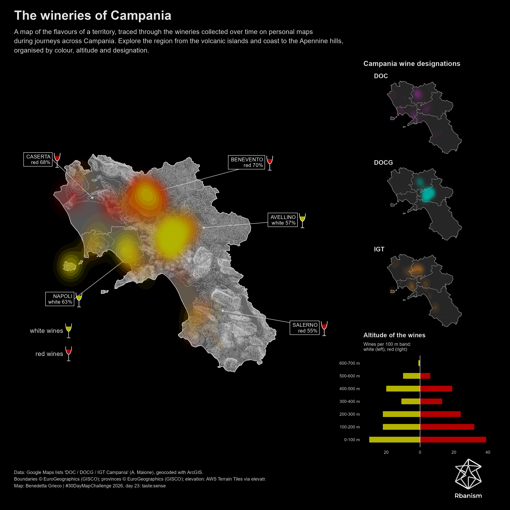

# 23Nov_Taste: The wineries of Campania

**Mapper:** Benedetta Grieco\
**Data:** Google Maps lists "DOC / DOCG / IGT Campania" (A. Maione), geocoded with ArcGIS; boundaries © EuroGeographics (GISCO) and GADM; elevation: AWS Terrain Tiles via `elevatr`

## About the map

This map showcases the region's wines and wineries. It is based on three Google Maps lists (DOC, DOCG and IGT Campania), which were created over time by two wine enthusiasts who collected wineries they discovered and grouped them by designation on personal maps. This is a personal selection, not a census of regional production.

Each wine has been geolocated and classified as white or red according to the grape variety. The main map shows where white and red wines are produced: yellow and red clouds over a grey relief with contour lines. This allows you to see how the production of wine is distributed across the landscape, from the volcanic islands and the coast to the Apennine hills. Around the region, a label for each province reports the prevailing colour and its share.

Three small maps on the right show where DOC, DOCG and IGT wines are concentrated, and a chart compares the number of white and red wines in each 100-metre altitude band.

Please note that altitude refers to the location of the winery, not its vineyards. Wineries listed without a specific wine were counted as producing both white and red wines.

## Process

This is my second map created using R, and it is one of my first experiences of programming. While I can read and understand code, I am not yet able to write it myself, so I used an AI assistant (Claude) to generate the code for me. My role was to define the idea, data, and design choices; run and test each step; read the errors; and ask for changes until the map matched my vision.

The process: First, I exported the wine lists from Google Maps and rebuilt them as a table. Then, I geocoded the wineries with Tidygeocoder (ArcGIS), correcting misplaced points by hand. I classified each wine as white or red based on its grape varieties, extracted altitude data from a DEM (Elevatr) and created the map using sf, terra, Tidyterra, ggplot2 and Patchwork.

The key takeaway is that places saved on a phone over the years can become a dataset that tells the story of a territory. Having used QGIS before, I found that every step is recorded in R, so the map can be recreated at any time. Building the map layer by layer showed me how much each design choice shapes what a map says.

## Files

- [`BenedettaGrieco_SenseTeste_23.11.R`](BenedettaGrieco_SenseTeste_23.11.R): R code
- [`23_taste-sense_BenedettaGrieco_nero.png`](23_taste-sense_BenedettaGrieco_nero.png): the map
- Data: [`vini_campania_colori.gpkg`](vini_campania_colori.gpkg), [`campania.gpkg`](campania.gpkg), [`province_campania.gpkg`](province_campania.gpkg), [`dem_campania.tif`](dem_campania.tif) and the Rbanism logo
- Original texts: [`map_description.txt`](map_description.txt), [`process.txt`](process.txt)
